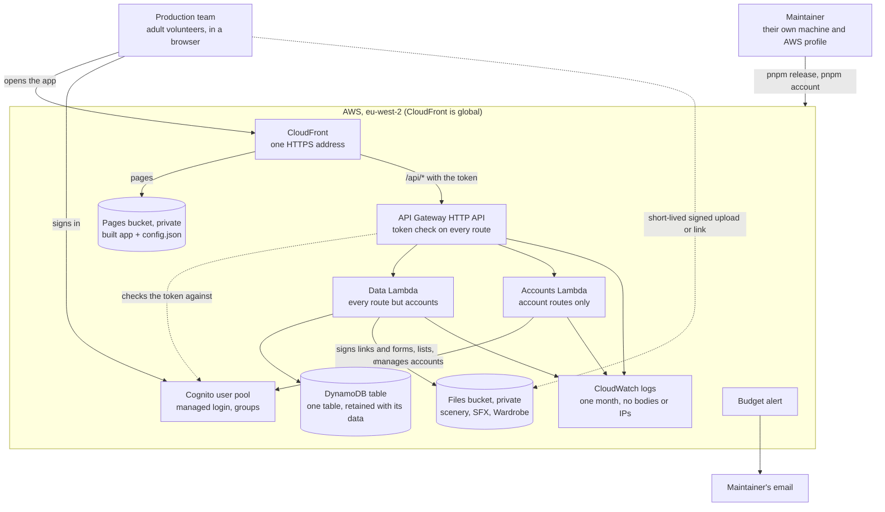
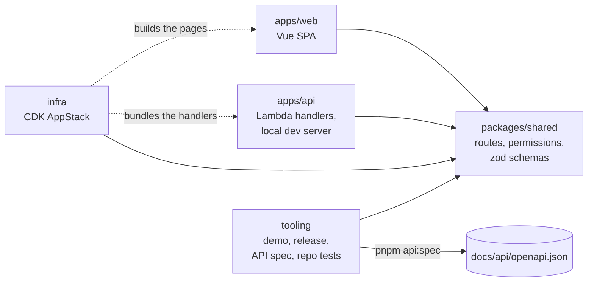
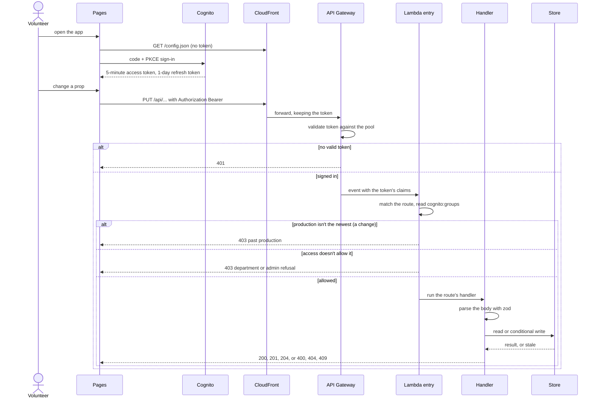
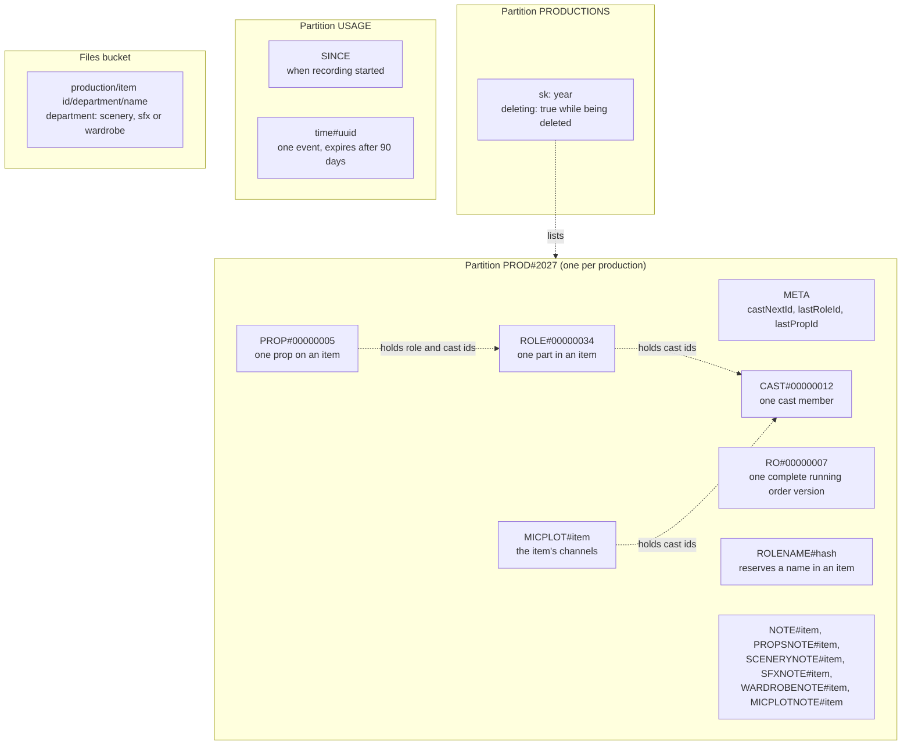
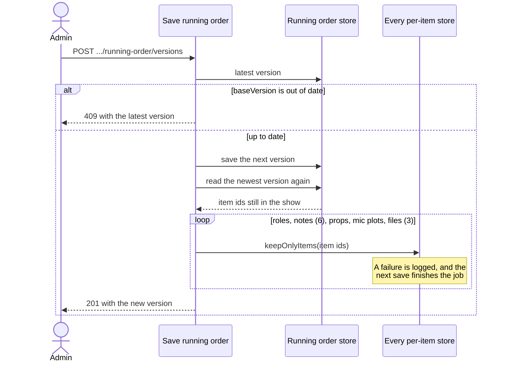
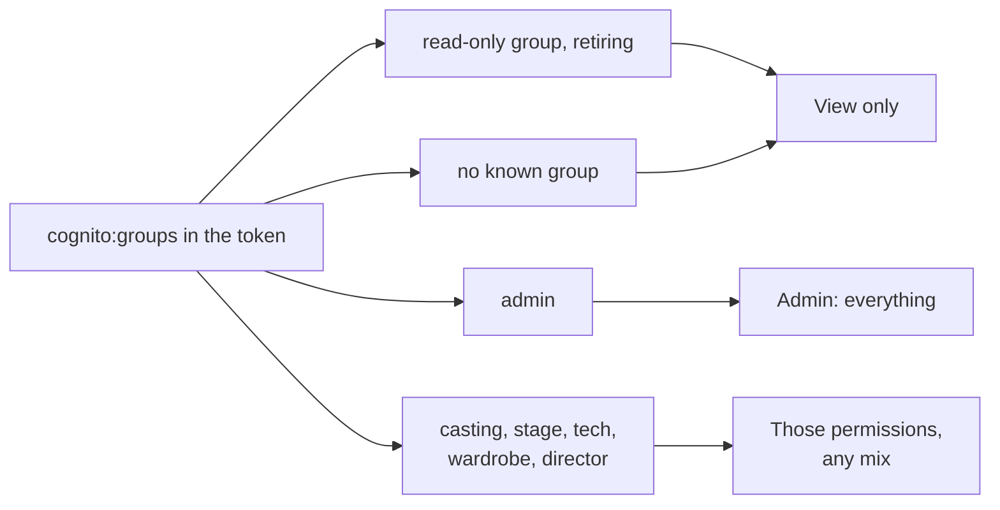
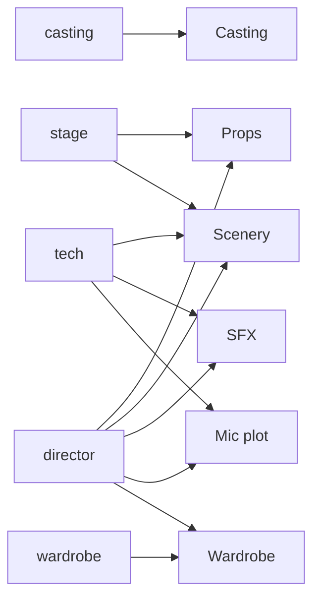
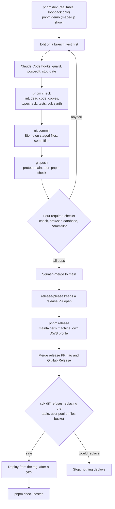

# Architecture

How iCUE fits together, one picture at a time. Each section starts with what it means for you, then gives the detail. The code wins if anything here disagrees with it: the sources are named as we go, and the [decision records](../adr) say why it's built this way.

- [The system](#the-system)
- [The code](#the-code)
- [One request, start to finish](#one-request-start-to-finish)
- [The data](#the-data)
- [Roles and department permissions](#roles-and-department-permissions)
- [From a change to a release](#from-a-change-to-a-release)

## The system

The production team opens one web address. Its pages and its API sit behind that address, every API call needs the team's sign-in, and the show's data stays in London. Nothing that names a cast member is public.

| Part | Detail | Source |
|---|---|---|
| CloudFront | Default behaviour serves the pages, `/assets/*` is cached for a year (each name holds its content), and `/api/*` goes to API Gateway uncached, with every header but `Host`. Security headers, including a strict content security policy, on all of them | `infra/lib/pages.ts` |
| Sign-in | Authorization code + PKCE, public client, no self sign-up, no email or phone, 5-minute access and ID tokens, 1-day refresh token | `infra/lib/app-stack.ts`, [ADR 0018](../adr/0018-access-control-with-cognito.md) |
| API Gateway | JWT authorizer on every route and on the `$default` catch-all, so an unknown path gets `401`. Stage limit 20 requests a second, burst 40; `POST /api/usage` 5 and 10 | [ADR 0017](../adr/0017-hosting-on-lambda-and-cloudfront.md), [ADR 0024](../adr/0024-limit-usage-recording-and-count-sign-ins.md) |
| Lambda | Two Node 24 ARM functions, 256 MB, 10-second limit. Only the accounts function may touch accounts. The data function may reach the table and only the three departments' file folders | `infra/lib/app-stack.ts` |
| Table | One table, `pk` and `sk`, 7-day point-in-time recovery, deletion protection, retained if the stack goes | [ADR 0015](../adr/0015-dynamodb-for-production-data.md) |
| Files bucket | Blocks all public access, S3-managed encryption, HTTPS only, no versioning, retained if the stack goes. Browsers reach it only with a signed form or link lasting 5 minutes | [ADR 0030](../adr/0030-scenery-files-in-a-private-bucket-named-by-key.md), [ADR 0032](../adr/0032-sfx-files-beside-scenery-files.md) |
| Alerts | One monthly AWS budget ($7, about £5), emailing when forecast or actual spend passes it. The address is given at deploy time and never committed | `infra/lib/app-stack.ts` |

## The code

One repository, four packages. `packages/shared` is the contract: every other package imports it, and nothing is allowed to define an API shape or a permission anywhere else. Change it first, and the type checker shows everything that needs to follow.

- **`routeKeys`** lists every route as `"<METHOD> <path>"`. The API has a handler for each, infra hosts exactly these, and the spec documents exactly these.
- **`routeNeeds` and `departments`** say who may use each route. The API enforces it, the pages hide what you can't use, and the post-deploy check tests it.
- **Zod schemas** check a request as it arrives. A strict schema refuses a field it doesn't name, so nothing beyond what's allowed (say, a date of birth) can be stored.
- Handlers stay thin. Logic is in plain functions, and storage is behind a store interface with two versions: DynamoDB or S3 when hosted, and local files for `pnpm demo` ([ADR 0006](../adr/0006-vanilla-lambda-shaped-api-handlers.md), [ADR 0015](../adr/0015-dynamodb-for-production-data.md)).

## One request, start to finish

A request passes three gates before it touches any data: are you signed in, is this production still open to change, and are you allowed to change this. A refusal stops it there, so a handler never runs for someone who isn't allowed.

The checks are in `apps/api/src/http/lambda-entry.ts` and `access.ts`, in that order; the rule on what may run is `accessFrom` and `needOf` in `packages/shared/src/api-routes.ts`. Only the token decides who someone is: the local server's access header is never read when hosted. Responses are sent with `Cache-Control: no-store`.

Two things never get an API token because they aren't API calls: `/config.json`, public by design, and the signed links and upload forms for item files, which are time-limited and open to whoever holds them.

## The data

Each production is separate, and one row in the table says what kind of thing it is. Deleting a production removes its whole partition and every file it owns, and cutting an item from the running order removes everything kept for that item.

Every row uses partition key `pk` and sort key `sk`, in the one table:

| `pk` | `sk` | Holds | Kept per item? |
|---|---|---|---|
| `PROD#<year>` | `META` | Counters for the next ids, and the mark that a cast list exists | no |
| `PROD#<year>` | `RO#<version, 8 digits>` | One complete, never-edited version of the running order | no |
| `PROD#<year>` | `CAST#<id, 8 digits>` | One cast member | no |
| `PROD#<year>` | `ROLE#<id, 8 digits>` | One part in one item | yes |
| `PROD#<year>` | `ROLENAME#<sha-256 of item and name>` | Reserves a role's name in its item, so two can't share it | yes |
| `PROD#<year>` | `PROP#<id, 8 digits>` | One prop | yes |
| `PROD#<year>` | `NOTE#<item>` and `PROPSNOTE#`, `SCENERYNOTE#`, `SFXNOTE#`, `WARDROBENOTE#`, `MICPLOTNOTE#` | Each department's notes on an item | yes |
| `PROD#<year>` | `MICPLOT#<item>` | An item's channels | yes |
| `PRODUCTIONS` | `<year>` | One row per production, marked `deleting` while it goes | no |
| `USAGE` | `SINCE`, and `<time>#<uuid>` | Usage events, removed by the table's time-to-live (`expiresAt`) after 90 days | no |

Roles, props and mic plots hold **ids, never names**: a cast member's name lives in one place, so removing them takes their name out of everything ([ADR 0010](../adr/0010-cast-member-personal-data.md)). Cast members hold only what [ADR 0010](../adr/0010-cast-member-personal-data.md) and [ADR 0014](../adr/0014-cast-singing-and-acting-notes.md) allow, enforced by a strict schema.

### Cutting an item takes all its data with it

Saving a running order that leaves an item out removes what's kept for that item. The save comes first, so a refused save deletes nothing. If part of the clean-up fails, the save still stands and the next save finishes the job.

`itemCleanupOf` in `apps/api/src/storage/data-stores.ts` builds this list: every store except the four show-wide ones, plus each department's files. A new per-item store joins it automatically, and the typecheck fails if it can't clean up after itself.

### Deleting a production

A past production can be deleted for good, in the request ([ADR 0037](../adr/0037-delete-a-past-production-marked-then-repeatable.md)). Its row is marked `deleting` first, so nobody can open it part way. Then its files go, then its partition, and last its row. Every step can be repeated, so a stop at any point is finished by asking again. Copies stay in the table's point-in-time backup for up to 7 days.

## Roles and department permissions

An account is an admin, or has any mix of department permissions. Reading is open to everyone signed in, and everything else is decided per route.

Which permission opens which department (`departments` in `packages/shared/src/api-routes.ts`):

| Department | Changed by | Admin? |
|---|---|---|
| Casting | `casting` | yes |
| Props | `stage`, `director` | yes |
| Scenery | `stage`, `tech`, `director` | yes |
| SFX | `tech`, `director` | yes |
| Mic plot | `tech`, `director` | yes |
| Wardrobe | `wardrobe`, `director` | yes |
| Accounts, starting or deleting a production, saving the running order, deleting a cast member, reading usage | nobody but an admin | yes |

Director can change every Production department, but never casting or the show itself ([ADR 0029](../adr/0029-director-permission-and-routes-naming-any-of-several.md)). Being in the retiring `read-only` group cancels every other group, including `admin`, until `pnpm account roles` has moved each account out ([ADR 0026](../adr/0026-department-permissions-as-user-pool-groups.md)).

A production that isn't the newest is view only for everyone, admins included, and the API refuses changes to it before looking at permissions ([simplify FR21](../product/simplify/prd.md)).

## From a change to a release

Work goes through a branch and a pull request, and shipping is a separate, deliberate step. Nothing deploys itself: a release needs the maintainer's own machine, their AWS profile and two yeses.

- **`browser`** is the phone-width layout tests ([ADR 0011](../adr/0011-browser-layout-tests-in-ci.md)), **`database`** the store tests against DynamoDB Local ([ADR 0016](../adr/0016-database-tests-against-an-emulator-in-ci.md)), and **`commitlint`** the PR title. `check` is the same `pnpm check` you run locally.
- `fix` makes a patch release and `feat` a minor one, from the Conventional Commit titles on `main` ([ADR 0004](../adr/0004-versioning-with-release-please.md)).
- `pnpm release <version>` redeploys or goes back to a tag, with nothing merged. The steps are in [the hosting guide](../guides/hosting.md).
- Local runs have no sign-in. They listen only on `127.0.0.1`, and `pnpm dev`'s data is the real table, so treat it as the real thing.
